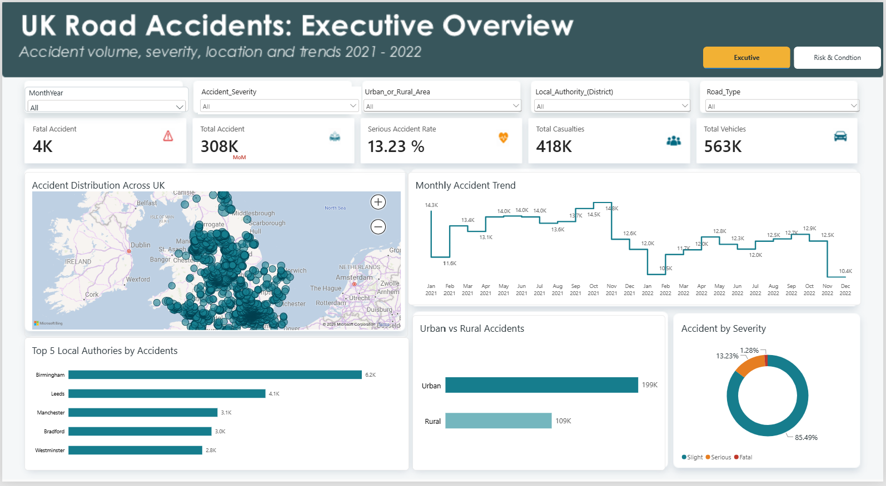
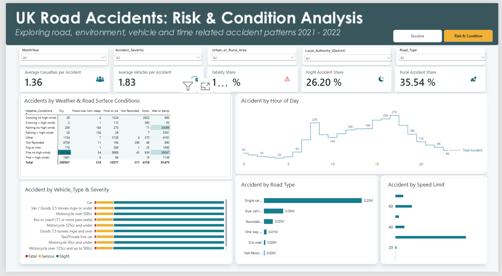

# UK Road Accidents Analysis (2021–2022)

## Project Overview
This Power BI project explores UK road accident data to identify patterns in accident severity, casualties, road types, weather conditions and lighting conditions.

## Tools Used
- Power BI
- Power Query
- DAX
- Data modelling and visualisation

## Dashboard Pages
1. **Executive Overview** — Key accident statistics, casualty trends and monthly comparisons.
2. **Risk & Conditions** — Analysis of accident severity across road types, speed limits, weather and lighting conditions.

## Key Findings
- Approximately 308,000 accidents, 418,000 casualties and 563,000 vehicles were recorded in the analysed dataset.
- Around 13.23% of accidents were classified as serious and 1.28% as fatal.
- Single carriageways accounted for the highest number of recorded accidents by road type.
- Roads with 30 mph speed limits recorded the highest accident counts.

## Project Files
- `UK_Road_Accidents_Analysis.pbix` — Interactive Power BI report.

## About Me
I’m an operations professional with over four years of experience, transitioning into data and operations analytics. I use Excel, SQL and Power BI to analyse data, uncover insights and support better business decisions.
## Dashboard Screenshots

### Executive Overview

### Risk & Conditions

